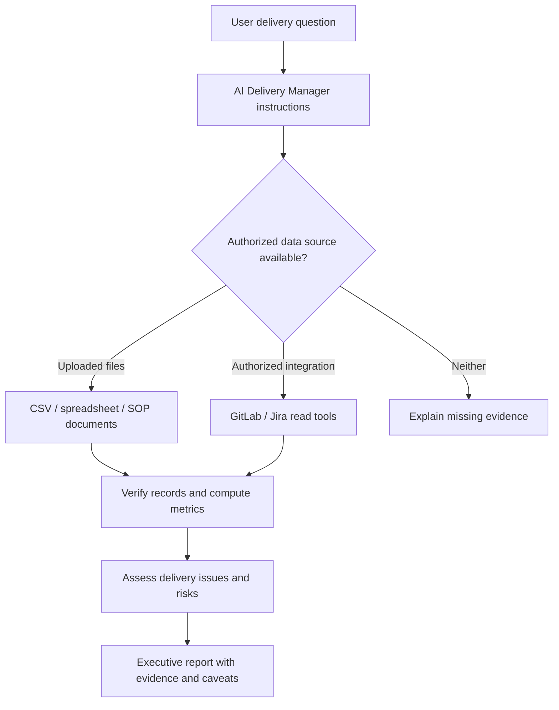

# AI Delivery Manager — Agentic IT Delivery Intelligence

**Portfolio demonstration | No-code / prompt-driven AI agent | Fictional data only**

AI Delivery Manager is a reusable AI-assisted delivery review workflow designed for IT Delivery Managers, , Technical Program Managers and Scrum Masters. It evaluates task progress, , blocked and overdue work, , delivery risks, , and produces concise executive status reports using user-provided project data or authorized live integrations.

> **Important:** This repository documents the agent's design, , sample prompts and synthetic evaluation data. It does **not** deploy a publicly accessible AI service or grant access to the author's private ChatGPT plugin or GitLab connection. Users need a compatible AI assistant and must connect their own authorized data sources.

## What it demonstrates

- **Tool-aware reasoning:** choose appropriate data/retrieval tools when they are available; never pretend to have called a tool.
- **Data-grounded analysis:** calculate completion, , blocked and overdue issues from evidence.
- **Workflow-aware reporting:** distinguish GitLab native issue state from workflow labels and custom status.
- **Risk evaluation:** separate actual issues from potential future impacts.
- **Executive communication:** concise health report with actions and conditional leadership attention.
- **Responsible operation:** read-only by default, , no secrets or sensitive employer data, , clear timestamps and source references.

## Architecture

See [Architecture](docs/architecture.md) for data flow and limitations.

## Quick start — no code required

1. Download this repository or open the files on GitHub/GitLab.
2. Use the sample file `sample-data/project-issues.csv` in a ChatGPT conversation with file analysis or a compatible agent.
3. Copy [agent instructions](prompts/agent-instructions.md) into your private reusable AI workflow, , or use [demo questions](prompts/demo-questions.md) in a conversation.
4. Ask for a delivery health report. Confirm the calculated values match the documented [evaluation cases](evaluation/test-cases.md).
5. Optionally connect your **own** GitLab/Jira account through an authorized integration. Verify read-only tool access before requesting a live report.

Sample task data is deliberately synthetic. It is not an export from a real company or GitLab account.

## Sample dataset

The example represents a cloud identity-platform modernization program, , with five distinct workstreams and a release on **18 Dec 2026**. The report snapshot is fixed at **25 Nov 2026** for reproducible comparisons. Synthetic statuses may be changed to test different scenarios.

| Metric (synthetic dataset, , 25 Nov 2026) | Value |
|---|---:|
| Issues | 12 |
| Completed | 3 |
| Completion rate | 25.0% |
| Blocked and incomplete | 3 |
| Overdue and incomplete | 4 |
| High/critical and incomplete | 7 |

Overdue means `due_date < 2026-11-25` and `workflow_status != done`; an issue due on the report date is **not** overdue. Completion uses the `done` workflow status, , not GitLab closed state alone.

## Example output

Read [sample executive delivery report](demo/executive-report.md) for a concise illustration. It is **not** a live GitLab report.

## Repository guide

| Path | Contents |
|---|---|
| `prompts/` | Reusable agent instructions and demonstration requests |
| `sample-data/` | Fully fictional project tasks and a risk register |
| `docs/` | Architecture, , governance SOP and operational boundaries |
| `evaluation/` | Expected metrics, , positive/negative tests, , review rubric |
| `demo/` | Example executive report |

## Limitations and boundaries

- Prompt instructions cannot by themselves enforce read-only permissions on an external tool. Tool access must be constrained by the connection and actual account permissions.
- No claim of autonomous scheduling, , production-grade security, , universal file-type support or a public hosted agent.
- Live integrations are optional and depend on each user's compatible ChatGPT configuration and authorized credentials.
- RAG recommendations are advisory; release approvals and corrective actions remain human decisions.
- The project uses no client/company data, , access tokens or personal records.

## Future roadmap

1. Add configurable status mappings and priority definitions.
2. Connect verified, , read-only GitLab/Jira retrieval with source timestamps and pagination.
3. Add document retrieval over versioned SOPs and release evidence.
4. Evaluate answer quality and tool-selection behavior on test datasets.
5. Explore approval-gated actions and scheduled reviews after security checks.

## Reuse and licensing

A software/content license has **not** been selected for this repository. Before inviting reuse or contributions, , choose an appropriate license and verify any third-party terms that apply to integrations. Public visibility by itself does not grant an open-source license.

## Author's note

Created as a hands-on Agentic AI learning and IT delivery management portfolio project. This is an educational demonstration, , not a production delivery-governance system.
